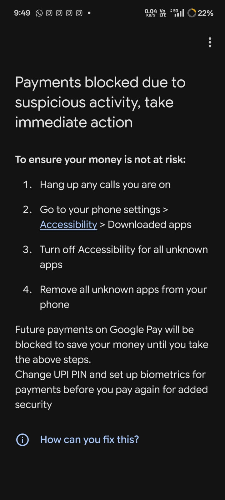

# Google Pay payments blocked after sustained dedgram use

- Reported: 2026-10-31 (Asia/Calcutta).
- First observed: 2026-10-30, according to the reporter ("yesterday").
- Severity: high; payment functionality was blocked and recovery was disruptive.
- Status: mitigation implemented in 2.2.2; affected-device verification pending. Suspected compatibility regression; causal version not yet established.
- Reported installed version: unknown. Repository version at intake: 2.2.1 (`338f85f`).

## User report

The reporter used dedgram for roughly two weeks or longer to collect bot-profile candidates while Google Pay worked normally. Google Pay then suddenly displayed a payment-blocking security warning. The reporter uninstalled dedgram, uninstalled and reinstalled Google Pay, changed their UPI PIN, restarted the phone, and took additional unspecified steps before Google Pay worked again. This interrupted payments and led them to remove dedgram entirely.

These actions are the reporter's recovery history, not a prescribed troubleshooting sequence. Because several interventions happened together, the report alone cannot isolate which action restored payments.

## Screenshot evidence

The original screenshot was attached to the reporting chat. It shows a Google Pay screen headed **"Payments blocked due to suspicious activity, take immediate action"**. Its instructions are to hang up calls, open phone Settings > Accessibility > Downloaded apps, disable accessibility for unknown apps, and remove unknown apps. It says future payments are blocked until action is taken, and asks the user to change their UPI PIN and set up biometrics before paying again. The screenshot status bar shows 9:49 and 22% battery; it does not establish an app version or calendar date.

The original attached image is preserved byte-for-byte as [google-pay-payments-blocked-original.png](google-pay-payments-blocked-original.png) (720 × 1600 PNG, 370,126 bytes). SHA-256: `6409e67ea8d071e1acc1dfee6f5cf2495bcb626bb8fd57118041abd4a4c6fa0f`.

## Expected behavior

Profile/reel collection must be explicitly controlled by the user, limited to Instagram, and easy to turn off completely without uninstalling dedgram. The app must explain that enabled accessibility access can affect compatibility with payment apps, even when collection is idle.

## Actual behavior

Google Pay blocked payments and directed the user to remove unknown accessibility apps. Dedgram's contribution is suspected, not proven by the screenshot: it names no specific app. Exact affected build, phone/Android version, Google Pay version, collection mode, and whether dedgram capture was active are not yet known.

## Investigation scope

1. Compare recent versions against the original accessibility implementation: declared capabilities, package filtering, overlay type, idle behavior, and automatic UI actions.
2. Establish whether a recent change increased permissions or exposed a longstanding enabled-service compatibility problem.
3. Implement least-privilege operation and a clear, complete stop/disable path; do not hide accessibility capabilities or bypass payment-app security checks.
4. Verify with Android unit tests, lint/build checks, and documented device acceptance checks. Keep Google Pay recovery unverified until tested on the affected phone.

## Implementation and verification

See [INVESTIGATION.md](INVESTIGATION.md) for commit evidence, the implemented mitigation, automated validation, and pending device checks. The updated installable artifact is [app/dedgram.apk](../../dedgram.apk). This issue remains open until the affected phone confirms the outcome.
